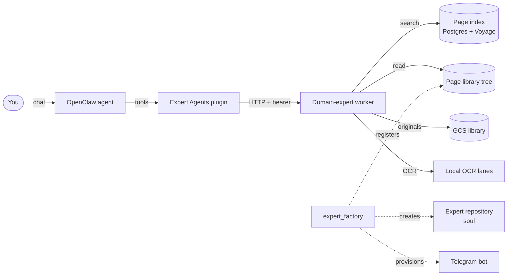

<p align="center">
  
</p>

<h1 align="center">Expert Agents</h1>

<p align="center">
  <strong>Build AI experts that answer from a library you choose — and cite every claim.</strong>
</p>

<p align="center">
  <a href="https://github.com/jamiezigelbaum/expert-agents/actions/workflows/verify.yml"></a>
  <a href="LICENSE"></a>
  
  
  
</p>

<p align="center">
  <a href="#quickstart">Quickstart</a> ·
  <a href="#how-it-works">How it works</a> ·
  <a href="#create-an-expert">Create an expert</a> ·
  <a href="#tools">Tools</a> ·
  <a href="docs/README.md">Docs</a>
</p>

---

Expert Agents turns an [OpenClaw](https://docs.openclaw.ai) assistant into a
team of specialists. Each expert has its own curated library — books, papers,
transcripts, web pages — kept as a page library: every page addressed, read
locally (text layer, then local OCR), and indexed for hybrid search. When you
ask it something, it searches and reads that library, answers with citations
back to the exact page, and says plainly when the library doesn't cover the
question.

You can create a new expert by asking for one in chat. The factory gives it its
own Git repository, its own page library, and its own Telegram bot, then
walks you through confirming each step.

## Why

General-purpose assistants blend everything they've read, and you can't tell
where an answer came from. Expert Agents gives you the opposite trade:

- **Bounded** — an expert answers only from the sources you approved, so you
  know what it knows.
- **Cited** — every answer points back to title, author and passage, so you can
  check it.
- **Honest about gaps** — when retrieval comes back thin, the expert says so
  instead of filling in from memory.
- **Yours** — each expert's persona, workspace and holdings live in its own
  repository; this repository is only the machinery they share.

## Features

- **Grounded answers** — hybrid keyword and vector search with reranking over
  page-addressed units, plus exact grep, whole-range reading and page images;
  every citation carries author, title and page.
- **Conversational factory** — `expert_factory` creates an expert end to end:
  repository and soul, page library route, and a managed Telegram bot.
  Progress is saved, so creation resumes cleanly after each confirmation.
- **Library intake** — `library_ingest` turns PDFs, EPUBs, Markdown and text
  into page units: the PDF text layer, then DeepSeek-OCR and a vision lane run
  locally for scans, with figures described. Every failed or empty page is
  listed; nothing is dropped silently, and no page is refused.
- **Approval-gated acquisition** — search book catalogs for candidates, then
  download and import only what the owner approves.
- **Document collaboration** — read, comment on, and apply approved edits to
  configured documents.
- **Safe by construction** — credentials enter only through a task-scoped
  adapter and never appear in output, logs or receipts; network fetches are
  DNS-pinned and allowlisted; every write is planned before it is applied.
- **One engine, many consumers** — marketplaces and expert providers call the
  same worker, so a retrieval improvement lands everywhere at once.

## How it works



| Piece | Where | What it does |
| --- | --- | --- |
| **Plugin** | `src/` | Registers the tools with OpenClaw and forwards calls to the worker. |
| **Worker** | `packages/runtime` | Plans, retrieves, cites, ingests and acquires. Runs as a systemd service or container. |
| **Library** | `packages/library`, `packages/runtime` | Page units, local OCR and figure description, the page index, and ingest. (`packages/library-materializer` is the legacy Vertex import.) |
| **Factory** | `packages/provisioning` | Creates and resumes experts: repository, page library, bot and binding. |
| **Skills** | `skills/` | Tenant-neutral operating instructions the agent follows when using the tools. |

## Quickstart

**Requirements:** [Bun](https://bun.sh) 1.3+ to build. To run an expert you also
need an OpenClaw installation, a GCS bucket for originals, Postgres with
pgvector for the page index (`deploy/page-library/compose.yaml`), a Voyage API
key, and a local model router serving DeepSeek-OCR and a vision profile.

```sh
git clone https://github.com/jamiezigelbaum/expert-agents.git
cd expert-agents
bun install --frozen-lockfile
bun run verify
```

`verify` runs the full gate: boundary scan, TypeScript, every test, all builds,
plugin and deploy packaging, and a scan of the shipped artifacts. It never skips
a missing prerequisite, so green means green.

A successful build leaves two installable artifacts:

| Artifact | Install |
| --- | --- |
| `dist/plugin-package/` | The OpenClaw plugin. Install it with OpenClaw's plugin installer and restart the gateway in the same step, so the plugin registers after its secret references resolve. |
| `dist/deploy-package/` | The worker release. Follow the [deployment guide](deploy/README.md) for systemd or the container image. |

### Configure

Point the plugin at your worker. The bearer can be a literal or an OpenClaw
SecretRef; prefer the SecretRef.

```json
{
  "domainExpert": {
    "enabled": true,
    "baseUrl": "http://127.0.0.1:8040",
    "authToken": { "source": "env", "provider": "default", "id": "EXPERT_AGENTS_DOMAIN_EXPERT_AUTH_TOKEN" }
  }
}
```

The worker reads its routing — which domains exist, where their originals live
and their page library — from `EXPERT_AGENTS_DOMAIN_EXPERT_AGENTS_JSON`
(experts the factory creates are registered for you):

```json
{
  "history": {
    "displayName": "History Expert",
    "library": { "bucket": "<library-bucket>", "prefix": "<library-prefix>" },
    "pageLibrary": { "sourceId": "history" }
  }
}
```

Every environment field is listed in
[`deploy/systemd/domain-expert.env.example`](deploy/systemd/domain-expert.env.example).

## Create an expert

With the factory enabled (see [the factory guide](docs/FACTORY.md) for its
one-time setup), ask your OpenClaw agent:

> Create a climate-science expert that answers from the IPCC reports and the
> papers I give it. Call it Climate Expert.

The agent calls `expert_factory`, which:

1. Creates the expert's own Git repository with a purpose-based soul (or runs
   the guided `soul-workshop` if you want to shape its identity).
2. Registers its page library and seeds its workspace.
3. Returns Telegram's confirmation link for a new managed bot — you tap once.
4. Binds the bot to the new agent and checks readiness.

A new library starts empty. Add sources in chat (the agent uses
`library_ingest` and the acquisition skill), or from a shell:

```sh
bun run expert:library -- library-ingest --domain climate --action start --gcs gs://<library-bucket>/<prefix>/report.pdf --apply --approval-id <ref>
bun run expert:library -- library-ingest --domain climate --action status --job <job-id>
```

Then search it:

```sh
bun run expert:library -- library --domain climate --action search --query "sea-level rise drivers"
```

## Tools

| Tool | What it does |
| --- | --- |
| `domain_library` | The page library: catalog, search, grep, read, read_range and view_page, every result cited. |
| `library_ingest` | Add sources to the page library and report each page's outcome. |
| `domain_agent` | Plan or inspect a domain expert's configuration. |
| `annas_archive_search` | Search book catalogs for candidates without downloading. |
| `annas_archive_import` | Download and import an explicitly approved item. |
| `expert_factory` | Create, resume, or check on a new expert. Owner-only and disabled by default. |

And the skills that teach an agent to use them well: `domain-research`,
`expert-agent-workshop`, `expert-annas-archive-acquisition`, and
`soul-workshop`.

## Operator CLI

Everything the agent can do, an operator can do from a shell with
`bun run expert:library -- <command>`:

| Command | Purpose |
| --- | --- |
| `health` | Check the worker is up and authenticated, and the page library ready. |
| `library` | Query a domain's page library (`domain_library`). |
| `library-ingest` | Start, follow or list page-library ingest jobs. |
| `search` | Find candidate books for a domain. |
| `acquire` | Download an approved book and queue its ingest. |
| `ingest` | Legacy owner lane: stage into the shared GCS library and materialize into a Vertex corpus. |

`bun run library:pages` and `bun run library:index` build and index a whole
library on the host that holds it ([page library](docs/page-library.md)).

The worker token is read only from `EXPERT_AGENTS_WORKER_TOKEN` or a token file —
never from an argument, and never printed. `--help` on each CLI is the full
reference.

## Project layout

```
.
├── src/                          OpenClaw plugin entry and tool schemas
├── packages/
│   ├── runtime/                  domain-expert worker (HTTP server)
│   ├── library/                  library model, page units, OCR and ingestion
│   ├── library-materializer/     legacy: plan/execute import into Vertex corpora
│   └── provisioning/             expert factory and agent-repository scaffolding
├── skills/                       OpenClaw operating skills
├── scripts/                      operator CLIs, packaging and verification gates
├── deploy/                       systemd unit, container image, env examples
├── docs/                         architecture and operating guides
└── test/                         repository-level tests
```

## Documentation

| Guide | Covers |
| --- | --- |
| [Factory](docs/FACTORY.md) | Setting up and running conversational expert creation. |
| [Page library](docs/page-library.md) | Page units, local OCR, the search index, and the library tools. |
| [Agent repository contract](docs/AGENT_REPO_CONTRACT.md) | What each expert's own repository contains, and deployment postures. |
| [Deployment guide](deploy/README.md) | Installing, configuring, upgrading and rolling back the worker. |
| [Retrieval evaluation](docs/RETRIEVAL_EVAL.md) | Measuring answer quality against a question set. |
| [Architecture](ARCHITECTURE.md) | The boundaries every change keeps. |

The full index is in [docs/](docs/README.md), and open work is in [PLAN.md](PLAN.md).

## Contributing

Contributions are welcome. Read [CONTRIBUTING.md](CONTRIBUTING.md) first — the
short version is: keep the runtime tenant-neutral, keep secrets out of output,
and make `bun run verify` pass. Please report security issues privately as
described in [SECURITY.md](SECURITY.md), not in a public issue.

## License

[MIT](LICENSE)
